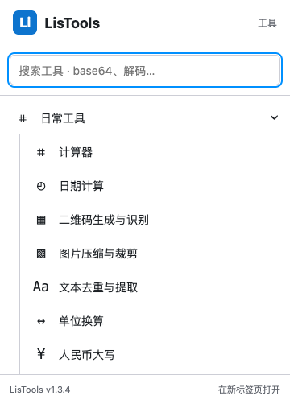

# LisTools v1.3.4 跨浏览器本地测试包

验收日期：2026-10-21。交付范围按用户选择为桌面浏览器的本地测试包和安装说明，保留既有工具及当前完整工作树的其他修改；不提交扩展商店或申请开发者账号。

## 复用与修改

共用一个 Manifest V3 清单、同一套页面和算法、同一个 ZIP。没有新增生产依赖、后台脚本、网页访问权限或数据上传。补充 Firefox 稳定扩展 ID、Firefox 140+ 和 Safari 18+ 的目标设置，编译同时考虑 Chrome 120、Firefox 140、Safari 18；这些最低版本是兼容目标，不代表全部完成对应旧版本的实机验证。

菜单优先使用原生 `browser.tabs`，并兼容 `chrome.tabs`，无需引入 API 包装库。原有工具、50 种语言、左侧转换目录和转换核心继续复用。

跨引擎回归复现了 WebKit 图片问题：Canvas 编码会生成 APP1 元数据，原有压缩库在 Safari Worker 中会调用 DOM 的 Image。修复保留现有 browser-image-compression 主流程，在缺少 DOM 的分支复用它公开的 canvasToFile 编码接口；JPEG 输出统一移除 APP1 段，并保留图像数据及色彩配置。回归覆盖目标压缩、保持尺寸、显式降低尺寸、EXIF 方向和移除元数据。

## 实测结果

| 检查 | 结果 |
| --- | --- |
| `npm test` | 262 项通过，0 失败 |
| `npm run build` | 成功，版本、许可证、语言块和离线资源检查通过 |
| Chrome 页面回归 | 54 项通过 |
| Edge 155.0.4283.62 页面回归 | 54 项通过 |
| Firefox 157.0 Playwright 独立测试引擎 | 54 项通过 |
| WebKit 27.2 独立测试引擎 | 54 项通过 |
| Edge 真实 MV3 加载 | 通过；真实工具栏弹窗、搜索打开新标签页、关闭与重新打开、Escape、18 个扩展页面、离线 CSP 和 Unicode Base64 Worker 均通过，无页面异常 |
| 普通版 Firefox 158.0.1 | Mozilla 官方 DMG 解包并验证代码签名；使用 Mozilla 官方 web-ext 10.8.0 成功临时安装最终 dist，扩展 ID 为 `listools@souvenirser.github.io` |
| Safari 原生临时安装 | 未执行；未更改用户 Safari 开发者设置。WebKit 页面通过不能替代此项 |
| Brave、Opera、Vivaldi | 共用 Chromium 扩展结构与资源；未分别实机安装，不列为已完成验收 |

216 项页面测试覆盖全部 18 个工具页首次加载和菜单、JSON 大整数与差异 Worker、时间戳 0 / UTC、MD5 标准摘要、原有文件操作、PDF、图片、二维码、50 语言切换、RTL、窗口布局、计时与测速状态。弹窗另覆盖 browser 单独存在、chrome 单独存在、两者并存三种环境。

Firefox 的首次启动在打开空白页前便报配置目录不存在。与 [Playwright 上游 macOS 问题](https://github.com/microsoft/playwright/issues/42768)一致，测试时使用独立 `CFFIXED_USER_HOME` 应用数据目录，未修改用户 HOME、系统访问权限或真实浏览器数据。四个项目放在同一次 Playwright 执行中，避免多个进程同时清理报告目录。

Mozilla web-ext 清单与代码扫描为 **0 errors、14 warnings**。其中一项为 Android 最低版本提示，本轮没有声明 Android 分发；其余涉及已有模板 innerHTML 和第三方打包代码的 Function 构造等静态提示，正式签名前仍需人工审阅。没有为绕过提示而放宽 CSP 或允许 unsafe-eval。

## 包核验

- 文件：`releases/LisTools-1.3.4.zip`；2,521,529 字节，186 个资源，含 18 个工具页面及弹窗。
- SHA-256：`0034df8ab80794a4895b09d53f073dc46f82c6be47717b0563373a331adcec50`。
- ZIP 与最终 dist 文件集合、每个文件的字节逐一相同。
- 构建输入 SHA-256 为 `6c3453214ce23a12b747b810769bfb90f5d3fe541eee530c0397a01fe3e6de7b`，构建后核验保持一致。
- package、lockfile、manifest 版本均为 1.3.4；没有 API permissions 或 host_permissions，资源、Worker 和语言均本地打包。
- 测速仍是唯一主动联网功能，继续受既有两个固定公共端点约束。工作区并行的测速界面修改已保留并包含于本次完整构建。

Edge 真实工具栏弹窗截图：

## 安装与分发边界

[README 安装说明](../README.md)分别提供 Chromium 浏览器解压加载、Firefox 临时加载和 Safari 临时加载步骤。Safari 提供“添加临时扩展”的版本可按 [Apple 官方说明](https://developer.apple.com/documentation/safariservices/running-your-safari-web-extension)选择同一目录或 ZIP，临时扩展在退出 Safari 或 24 小时后移除；用户按浏览器提示完成本机身份验证。本次没有操作这些 Safari 设置。

Firefox 普通版长期安装仍需 Mozilla 签名。Safari 旧版本、iOS 测试及长期分发按 Apple 官方应用打包与签名流程处理。本 ZIP 是本地测试资源包，不是已签名 XPI 或 Safari 应用，也没有代表用户发布商店。
