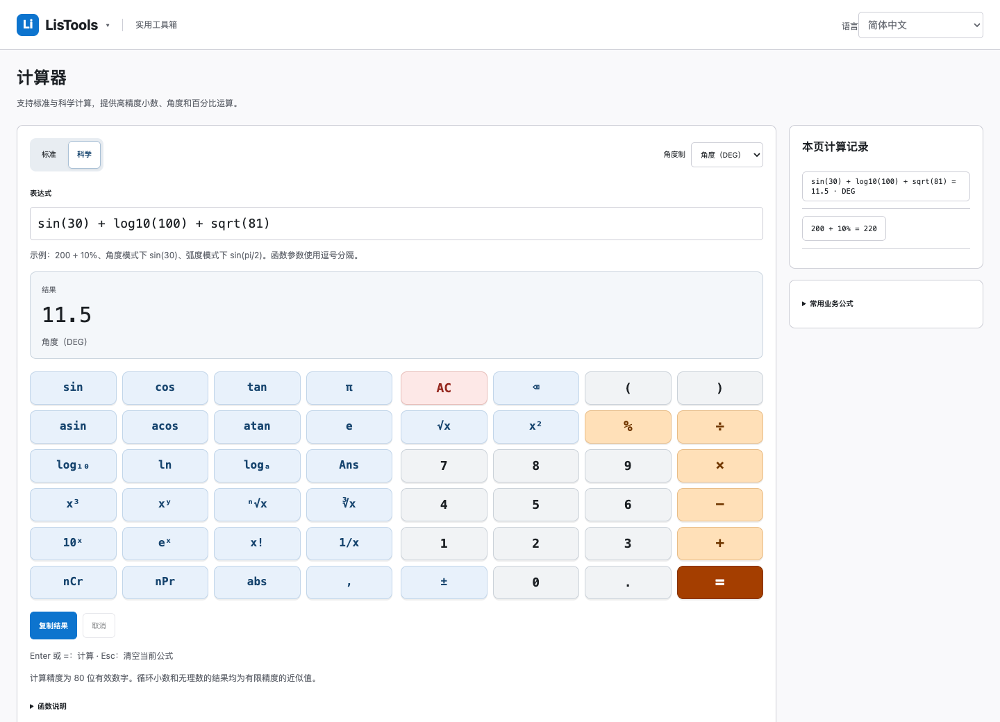
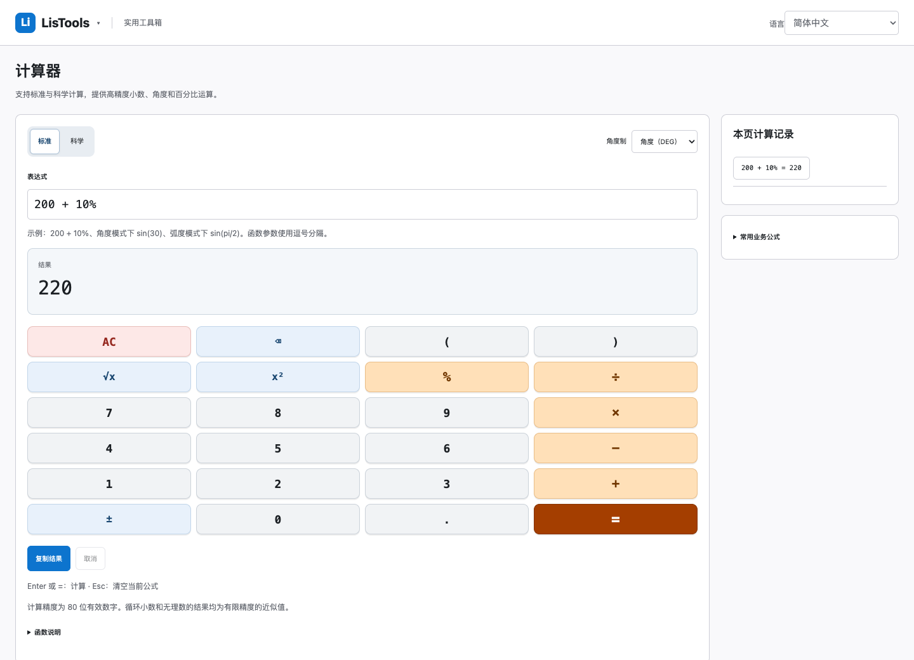

# LisTools v1.4.0 科学计算器验收

验收日期：2026-10-21。沿用当前工作树，保留并行的跨浏览器、测速、反馈与支持页改动。没有提交、推送或发布。

## 交付内容

- 标准 / 科学模式、DEG / RAD、三角与反三角、对数与指数、幂和根、阶乘与排列组合、π、e、Ans。
- 数字浅灰、函数蓝灰、运算浅橙、等号深橙、AC 浅红；键盘 4 列，宽屏科学区与数字区并排，窄屏上下排列。
- 沿用 80 位计算、24 位显示、复制完整计算值、30 条页面内历史、Worker 取消及 2.5 秒超时。办公公式默认折叠。
- 新增及修改的 45 个词条已覆盖 50 种语言，每种语言 calculator 共 74 个键；数学标识符保留原值。键和占位符检查通过，其他语种专业术语尚未经母语人员逐项审校。
- 新增运行依赖 0；复用现有 math.js 15.2.0。API permissions 和 host_permissions 均为空。

## 验证结果

| 检查 | 结果 |
| --- | --- |
| 改动前 `npm test` | 262/262 通过 |
| 最终 `npm test` | 272/272 通过；包含本轮新增测试及并行反馈任务新增测试 |
| Chromium / Firefox / WebKit 全量页面测试 | 195/195 通过，每个引擎 65 项 |
| 三引擎计算器、数值工具、离线入口专项 | 63/63 通过 |
| 真实 Manifest V3 离线加载 | Chrome for Testing 149.0.7827.55 通过；标准 220、科学 11.5、RAD 1，无页面异常、无 HTTP 请求 |
| 窄屏与无障碍 | 320px 阿拉伯语 RTL 无横向溢出，五类按键文字对比度 ≥4.5:1，按键高度 ≥44px |
| 依赖 / 权限 | 40 个直接运行依赖，无新增依赖、权限或计算器联网行为 |
| 扩展资源构建 | Vite 成功，最终 dist 可加载；打包状态见下文 |

Firefox 使用项目此前已验证的独立 CFFIXED_USER_HOME 目录，避免本机 Firefox 启动前的配置目录错误，没有修改用户 HOME 或真实浏览器数据。复现命令：

```sh
npm test
CFFIXED_USER_HOME=/private/tmp/listools-calculator-firefox npm run test:cross-browser
```

新增回归覆盖：`0.1+0.2`、百分比、DEG/RAD、反三角、正负特殊角、`7*pi/2`、`90±1e-78`、极小合法数值、正切近极点精度、非法定义域和参数个数、floor/ceil 可选精度、Ans 完整精度与 `2Ans` 历史复现、语言/模式切换、选区与键盘操作、Worker 错误恢复/超时/取消。

独立代码复核发现的问题已修复并增加回归：严格参数数量校验；先归约再转换角度；负角按奇偶性恢复；正切使用归约后的正余弦之比；显式有理数 π 倍数复用 math.js Fraction 识别，避免一般符号化简吞掉微小偏移。复核最终 24 条专项断言通过，没有遗留可操作问题。

## 资源体积与打包状态

- 对比既有 `LisTools-1.3.4.zip`，计算器页面脚本由 4,184 字节增加至 8,515 字节。
- 当前 dist 共 187 个资源、7,812,290 字节；此前 ZIP 解压资源为 7,735,555 字节。这个完整工作树对比包含并行任务，不能全部归因于计算器。
- package、lockfile、manifest 版本一致为 1.4.0。现有 1.3.4 及更早包均保留。
- **按用户选择，本轮先交付可加载目录 `dist/`，支持页资源齐全后再打包完整 v1.4.0 ZIP。** 并行新增的支持页要求 `public/support/alipay.png`，当前缺少该资源；`scripts/package.js` 因此拒绝打包。没有绕过完整性检查，也没有提供早于最终修复的候选包。
- 构建仍提示现有较大的 JSON / 单位模块分块，未为此扩大本轮重构范围。


## 界面




