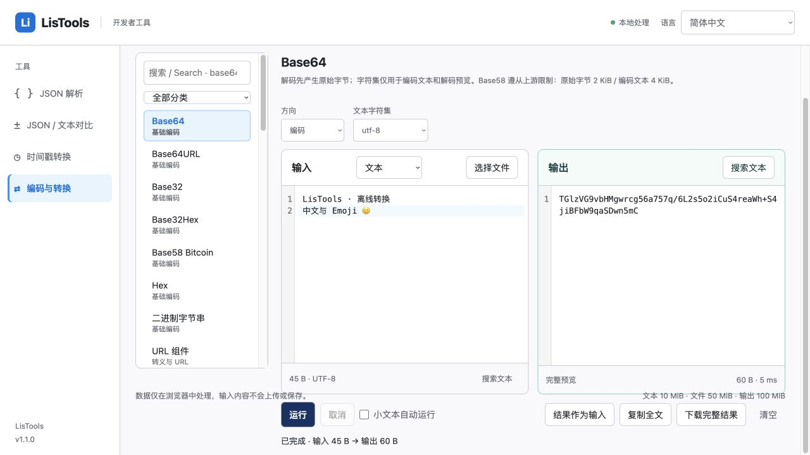

# 编码与转换工作台验收

状态：v1.1.0 本地候选版本，未发布。已发布 v1.0.0 保留。测试数据均为合成样例。

## 实现与复用

新增 `convert.html`，主导航一个入口；36 个工具、8 类，统一 CodeMirror 输入/预览和可取消模块 Worker。算法使用锁文件中的专用开源依赖；字符集表、格式和摘要组件按使用情况加载，所有资源随扩展打包。没有新增框架、服务端、网页访问权限或远程脚本。

完整功能与格式映射见 README 的「编码与转换」。XML 为 fast-xml-parser 保序数组；属性为 `:@`、文本为 `#text`，反向仅接受该映射。JSON 使用现有 jsonc-parser 严格 visitor 与 LosslessNumber 保留数字字面量，不将 `__proto__` 或类似内部标记的用户字段覆盖。YAML 使用公开 AST/自定义标量接口；CSV 默认保持字符串，JSON 单元格模式必须显式选择。

输入、结果、JWT、密钥不写入地址、日志或持久存储。地址仅含工具 ID；继续复用既有语言偏好存储。HMAC 密钥在任务结束、取消或离开工具后清空。HTML/SVG 作为数据处理，不创建可执行内容。

## 实现时确认的边界

- 可编辑文本 10 MiB（UTF-8 字节），文件 50 MiB，单次输出/解压 100 MiB，预览 1 MiB。文件中字节或编码文本按文件上限处理；只读预览不参与实际转换。
- Base58 遵从 [@scure/base 上游边界](https://github.com/paulmillr/scure-base#base58-is-on2-and-radixes)：原始字节 2048、编码字符 4096。界面明确提示，大文件使用 Base64/Hex；不改写上游平方级算法。
- 压缩使用 fflate 同步流；其解码器不验证 CRC/Adler，且实测会接受部分截断头部，因此解压使用原生 DecompressionStream，在本地 Worker 中逐块累计大小并终止超限流，不创建 Blob Worker。[Compression Standard §3](https://compression.spec.whatwg.org/#supported-formats) 规定校验与截断行为。Gzip 仅支持单个 member，拒绝拼接及尾部垃圾数据。
- CodeMirror 显式按 LF 分行，CR 字符原样保留，避免编辑器默认统一换行。混合样例 `a\r\nb\rc` 的 Base64 为 `YQ0KYg1j`，浏览器复验通过。
- 结构格式转换保留数据值与约定映射，不保留注释、源排版和引号选择。XML 遇到上游保留的危险属性名时明确拒绝，不改名或静默丢弃。
- 转换详情提供中文/英文；其余界面语言回退英文，算法诊断保留中文或上游原文。既有工具与 50 个语言包保持兼容。

## 自动回归

最终执行 `npm test`：**114/114 通过**（包含并行任务新增回归）。覆盖现有 JSON、差异、时间戳、多语言、视觉及新增转换测试。新增测试包括：

- 中文、Emoji、NUL、BOM、全部 256 种字节，7 类字节编码往返；省略补位、非法字母表、非零填充位、Hex 奇数位。
- URL / URI / 表单的 `+`、`%2B`、`%20` 语义；实体、JSON/Unicode 转义及码点，只解析数据而不执行表达式。
- 9 个字符集非 ASCII 固定向量、来源文件转码、非法 UTF-8、不可表示字符与孤立代理项。
- YAML 大整数/长小数/巨大指数/负零、重复键、非字符串键、循环和别名上限；XML 混合内容、命名空间、属性、CDATA、注释、DTD 拒绝、数字字符引用解码和非法码点/多根文档拒绝。
- CSV/TSV 引号和单元格换行、重复表头/不齐列数、显式 JSON 单元格；JSON Lines 行列与精度；Query 重复参数、空值和特殊键，以及 JSON 转义产生的孤立代理项拒绝。CSV 空单元格显式加引号，非空零列表格报错。
- 标准摘要、RFC4231 HMAC、BLAKE3 空输入及 CRC32 已知向量；三种压缩与三种传输表示的往返、校验和损坏、截断、尾部垃圾及解压超限。
- BigInt 进制、SI/IEC 区分与 Decimal 舍入标记、颜色 alpha/量化、文本选择操作与混合换行保留。
- 实际 Worker 的任务 ID、Blob、终止及错误后新任务；模拟缺少新版 TypedArray Base64 API 的 1 MiB 库回退往返。
- 控制器自动/手动阈值、队列取消、旧消息/错误隔离、启动失败恢复；文件拖拽默认 JSON 文案及自定义文案兼容。

`npm run build` 包含 Chrome 120 目标构建、四个页面、本地资源、完整许可证与 NOTICE、50 个语言包和 ZIP 根目录检查。旧 v1.0.0 ZIP 不覆盖。生产构建仍有既有 JSON 编辑器大块提示，不作为失败或性能承诺。

## 浏览器验证

使用独立生产预览目录与扩展一致的 CSP（`connect-src 'none'`、`worker-src 'self'`、脚本仅本地），避免并行任务重建 dist 时使已打开页面的哈希资源失效。当前自动化浏览器为 Codex 内嵌浏览器，**不等于真实 Chrome 扩展协议验收**。

已验证：中文/Emoji Base64、结果回填后解码、全部 256 字节文件编码/解码、原始字节 Hex 预览、混合换行保真、YAML 大数与长小数、HMAC 完成清空密钥、350 ms 小文本自动运行、修改输入立即禁用旧结果、50 MiB SHA3 任务取消后不可导出、文件只读预览、语言切换保留输入和结果。640、900、1440px 页面宽度均未发生整体横向溢出。浏览器日志无 CSP/Worker 错误。另已回归旧页面：JSON 大整数美化成功、JSON 对比正确显示一处大整数差异、时间戳 0 在 UTC 显示 1970-01-01T00:00:00.000+00:00。

内嵌浏览器剪贴板不可用，已确认显示失败提示；Blob 下载的完成事件未由自动化接口返回。因此成功复制和落盘下载保留为真实 Chrome 的人工验收项，自动测试仅证明完整 Blob 与预览分离，不能替代浏览器下载验收。

## 性能实测

2026-10-15，本机合成文件，内容为重复 ASCII `a`。仅为本次环境的样例，压缩数据高度可压缩，不代表随机数据、所有算法或 Chrome 120 的性能。

| 输入 | 内嵌浏览器 Base64 Worker | Node 26 Base64 | Node SHA-256 | Node Gzip（Base64 输出） |
| --- | ---: | ---: | ---: | ---: |
| 1 MiB | 18 ms | 2 ms | 12 ms | 13 ms |
| 10 MiB | 35 ms | 8 ms | 35 ms | 60 ms |
| 50 MiB | 134 ms | 82 ms | 182 ms | 311 ms |

浏览器三个文件均手动执行，输出分别约 1.33、13.33、66.67 MiB，仅渲染前 1 MiB，界面操作保持可用。耗时为任务内部统计，不包含编辑器渲染、复制或下载。

## 独立审查与公开信息检查

一次独立只读审查后，补上并验证了以下边界修复：XML 数字字符引用（含属性和补充码点）、XML 1.0 非法码点与多根文档、Query JSON 转义中的孤立代理项、CSV 零列表格与空字符串行。均先运行失败回归，再修正为通过。51 MiB 解压结果作为输入因文件上限被拒绝时，浏览器复验确认原结果仍保留，下载按钮仍可用。

源码及 ZIP 的敏感模式检查未检出本机用户名、用户目录绝对路径或私钥/访问密钥模式；既有诊断文档中的本机目录已改为项目名。Git 本地作者配置为 souvenirser 与 GitHub noreply 邮箱；本次没有新增提交，也没有发布 Release。上游许可证版权署名保留。

## 发布前人工验收

以下尚未完成，不能据 localhost 成功宣称已经完成全部阶段验收：

- 在真实 Chrome 120 和当前稳定版分别加载 dist，验证扩展图标入口、四页导航与模块 Worker 的本地懒加载。
- 断网验证字符集表、格式和摘要依赖可用，无远程请求、无扩展 CSP 错误。
- 验证原生剪贴板成功复制完整结果（含超过 1 MiB 的结果），以及权限失败提示。
- 实际下载文本、字符集输出和二进制压缩结果，与输入或已知向量逐字节核对。
- 文件读取期间切换输入/工具、取消再运行、键盘执行、拖拽、超过边界后恢复。

人工验收完成前保持候选版本，不创建 Git 标签或 GitHub Release。
