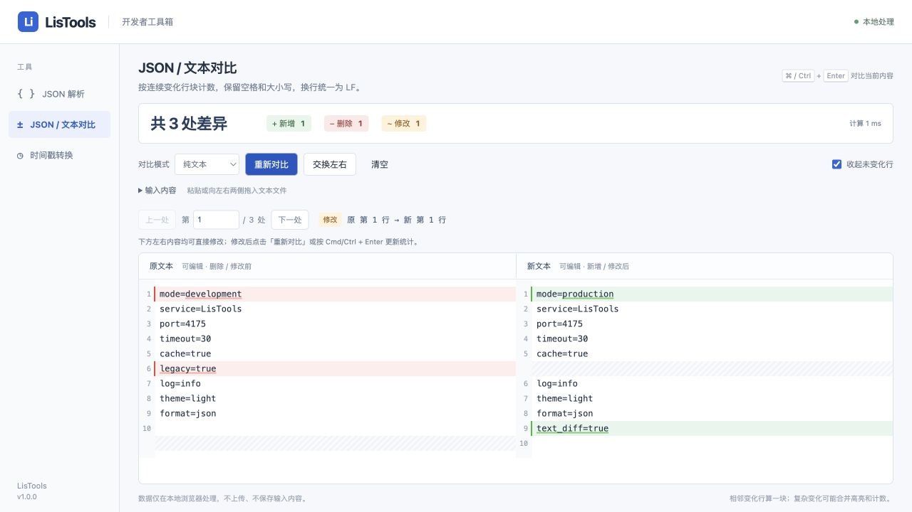

# 可编辑双栏与文本对比验收

日期：2026-10-15。本次为 LisTools 本地新增功能的验收，环境为 macOS、Node.js 26.4.0、npm 11.17.0。使用生产构建页面，HTTP 预览设置与扩展相同 CSP；未通过浏览器工具操作真实扩展协议加载。

## 交付行为

- 下方左右两栏均可编辑。更改后保留文档，清除旧数量并禁用旧路径导航，显示「内容已修改，待重新对比」；点击按钮或 Cmd/Ctrl + Enter 更新。
- 编辑器复用 CodeMirror 的输入、搜索、历史和虚拟渲染，局部 diff 有限时预算。全量比较放在 Worker，每次按键不复制两侧全文；新编辑终止旧 Worker。
- JSON 错误显示所在侧及行列，保留下方内容并可直接定位、修正。上方输入、下方编辑、交换、文件导入和模式切换使用当前内容，防止编辑后仍拿旧输入比较。
- 纯文本模式不做 JSON 校验。保留空格与大小写，CRLF/CR 统一 LF；按连续变化行块统计，显示两侧行号。支持一侧为空和两侧都为空。
- JSON 模式继续按字段计数并统一排版；模式切换沿用当前显示文本。排版改变了文档的一侧会重新建立历史，其余情况保留原生撤销重做记录。

## 回归与问题修复

新增回归先验证失败，再实现通过，覆盖普通文本、相邻与远距离变化、增删修改、空文本、换行规范化、百万字符单行、十万行文本、50 MB 末尾再次编辑、局部编辑坐标、历史保留及模式切换的旧响应隔离。Worker 协议测试同时验证 JSON 和纯文本。

浏览器中发现并复现的三个问题已修复：

1. 字符级 diff 在 50 MB 文本末尾编辑后把远距离变化合成一个大块：改用 [JsDiff](https://github.com/kpdecker/jsdiff) 9.0.0 行级比较，再细化行内变化。
2. 初始 Worker 全文位置不能复用于后续局部编辑；每个新 MergeView 只消费一次全文差异，之后比较当前局部文本。重新创建相同文档时通过原生 historyField 初始化保留撤销历史，避免在更新配置时误用尚未消费的全文坐标。
3. CodeMirror 默认 Cmd/Ctrl + Enter 插入空行，与页面比较快捷键冲突：页面在捕获阶段处理比较，防止文本被意外改变。

复杂文本仍有预算：行级 maxEditLength=2,000、timeout=1,000 ms，行内细化总预算 250 ms。达到预算时允许合并为较粗的文本差异块，因此复杂文本计数是显示块数，不是字符修改次数；JSON 字段统计不受其影响。算法预算不包含读取文件、分词、数据传输或视图初始化，不代表端到端硬时限。

## 浏览器实际结果

| 操作 | 结果 |
| --- | --- |
| 下方原 JSON 修改为与右侧相同 | 顶部先显示待重新对比，重算后为 0 处 |
| 下方新 JSON 修改字段，使用快捷键比较 | 正确显示 1 处并定位 `/a` |
| 输入 `{"a": ]}` | 下方保留原文；错误定位聚焦新 JSON 编辑区，可继续修正 |
| 文本两处变化，中间有四行相同内容 | 显示 2 处修改，定位原/新第 2–3 行和第 8 行 |
| 比较后撤销、重做 | 撤销恢复修改前内容，重做恢复输入；快捷键比较不会新增换行 |
| 空文本及交换左右 | 两侧为空显示 0；单侧普通文本显示新增 1，交换后自动重算为删除 1 |
| 两份各约 50 MB 文本，200,001 行 | 3 处差异，首次 Worker 计算 620 ms，当前渲染 32 行 DOM |
| 在该文本下方末尾追加 `_EDIT` 后重算 | 仍为 3 处，Worker 计算 122 ms；可定位第 200000–200001 行，修改未丢失 |
| 两份各约 52 MB JSON，500,005 行 | 初次 3 处，Worker 计算 4,989 ms，当前渲染 46 行 DOM |
| 在大 JSON 末尾编辑、开始重算后继续编辑 | 旧任务取消，编辑区保持可见，旧导航禁用；再次重算为 3 处，4,579 ms，两个编辑均保留 |
| 新生产页面的控制台 | 大 JSON 编辑与重算期间没有 error/warn |

文本文件实际大小：左 50,600,008 字节，右 50,599,291 字节。JSON 文件：左 51,688,924 字节，右 51,688,456 字节。以上时间仅为当前设备单次 Worker 观测，不包含文件读取、传输和编辑器初始化，不是所有结构的性能承诺。

大文本第一次导入期间，浏览器自动化的文件选择和完整 AX 树读取出现过超时；改用较长的选择等待和只读局部 DOM 状态完成验证，没有读取大文档全文作为浏览器快照。

## 构建与边界

完整 `npm test` 45 项通过，修改文件的 `node --check` 和 `npm run build` 通过。发布目录为 `dist/`，ZIP 约 0.40 MB，根目录包含 manifest 和三个工具入口；JsDiff 的 BSD-3-Clause 许可证随包提供。测试样例和临时夹具不进入发布包。Vite 仍提示原 JSON 编辑器分块大于 500 kB，构建成功。

真实 Chrome 扩展加载仍需在扩展管理页重新加载 `dist` 手动确认；本轮浏览器证据来自相同 CSP 的生产页面。输入不上传、不持久化，无新增扩展权限。本次没有提交或推送远程 GitHub。

