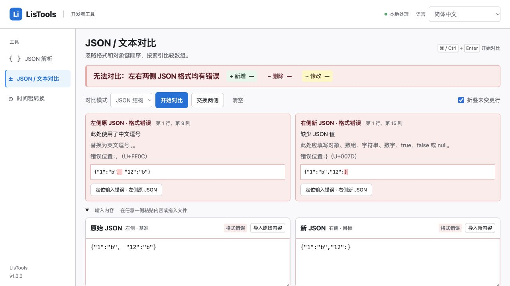
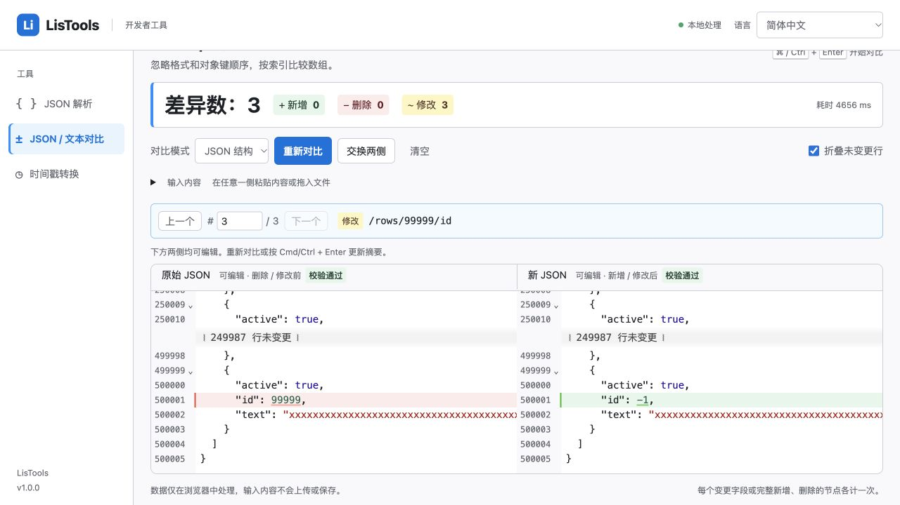

# JSON 对比中文错误诊断验收

日期：2026-10-15。项目：`LisTools`。

后续性能优化、完整回归和成功打包的最新结果见 [性能验收记录](./diff-performance-verification.md)。下文保留错误诊断修复当时的原始测量及构建状态。

## 修改范围

复用 jsonc-parser 的严格校验与访问器位置，保留 microdiff、JsDiff、CodeMirror 和 Worker。没有增加依赖，没有更改数字精度、结构差异计数或大文件编辑方式。

两侧独立校验，每侧只返回第一个明确错误。相同输入可以共用解析结果，但错误仍分别标注左右。语法错误、文件读取和工具执行故障使用不同类别；工具错误不归到右侧，也不将校验未完成的数据判为格式错误。

行列从 1 开始；LF、CRLF、CR 均可定位。未闭合字符串定位到文件末尾。诊断只携带附近的短片段，重复字段名及错误标记均限制长度，通过文本节点展示，不把输入作为 HTML 解释。

## 常见错误

| 类型 | 页面说明或建议 |
| --- | --- |
| 空内容 | 输入内容为空，提示粘贴或导入 |
| 中文逗号、冒号、弯引号、全角括号 | 指出具体字符及 Unicode 编号，建议英文标点 |
| 零宽空格、不可见连接符、正文中的 BOM、不换行空格 | 将不可见字符显示出来，提示删除 |
| 单引号或字段名未加引号 | 字段名和字符串必须使用英文双引号 |
| 缺少冒号 | 提示在字段名和对应值之间添加 `:` |
| 缺少逗号 | 提示在相邻字段或数组元素之间添加 `,` |
| 末尾多余逗号 | 提示删除结束括号前的逗号 |
| 缺少值 | 提示 JSON 允许的值类型 |
| 对象或数组未闭合 | 指出需要的 `}` 或 `]` |
| 字符串未闭合 | 提示缺少结束双引号，并定位到末尾 |
| 无效转义、Unicode 转义 | 提示合法转义格式 |
| 字符串中的裸换行或控制字符 | 提示使用 `\n`、`\r`、`\t` |
| 数字格式错误、前导零、指数未写完整 | 给出合法数字示例，前导零可改为字符串 |
| 注释、未结束的注释 | 提示标准 JSON 不接受注释 |
| 多个根值或末尾多余内容 | 提示只保留一个根值，多个对象可放入数组 |
| 重复字段 | 拒绝静默覆盖，并指出重复字段 |
| 非法 UTF-8、文件读取失败 | 标明导入失败所在侧，提示重新编码或重新选择文件 |
| 嵌套超限、处理容量超限 | 提示减少层级或拆分文件，不笼统归为内存不足 |
| Worker、差异计算、格式化、显示失败 | 显示中文工具阶段错误，不误报为右侧 JSON 不合法 |

## 自动化验证

先增加用例，原实现 15 项中 11 项失败，再修改代码。最终运行以下相关测试，35 项全部通过：

```sh
node --test test/json-diff-errors.test.js test/diff-diagnostics.test.js test/diff-controller.test.js test/diff-worker.test.js test/json-diff.test.js test/text-diff.test.js test/diff-editor.test.js
```

覆盖两侧独立错误、相同非法输入、16 个解析错误码、特殊字符、换行定位、EOF、严格 UTF-8/BOM、重复字段消息上限、解析/格式化/Worker 故障、错误后的重试、界面中文回退，以及已有精度、编辑历史、取消和大文件对比。`node --check` 和 `git diff --check` 通过。项目未配置 ESLint。

全量 `npm test` 当次为 88/90：其余失败属于同时开发中的转换工具解压校验及未齐全的 50 语言包。未改动这些模块来掩盖失败。

## 实际浏览器验证

使用 `vite build` 生成的生产页面，在本地预览中应用 manifest 相同的 CSP：本地脚本和 Worker、禁止网络连接。以下通过实际输入、导入和点击验证：

- 中文逗号：左侧第 1 行第 9 列，定位选中 `，`，显示 `U+FF0C`。
- 仅右侧错误和两侧同时错误：汇总、两张错误卡、各侧校验状态正确；定位按钮分别作用于对应输入。
- 下方原文编辑出错：两个编辑器保留，错误可定位；修正后使用 Cmd+Enter 能重新得到统计。
- 错误态新增、删除、修改和导航总数均为「—」，修正后恢复。
- 非法 UTF-8 导入：标明右侧导入失败，再点对比不会使用旧内容；重新导入 BOM 文件后恢复。
- CR 换行文件的错误定位与文件末尾定位有效；切到纯文本后，不合法 JSON 可以作为普通文本比较。
- 原始 `response_new.json` 与本地修改版：预期 3 处，页面显示 3 处，Worker 当次耗时 75 ms。
- 左右各约 50 MB JSON（51,688,924 / 51,688,456 字节）：显示 3 处，Worker 当次耗时 4,656 ms，仅 46 行 DOM；「下一处」依次到 `/rows/50000/text` 和 `/rows/99999/id`。
- 同等大小 JSON 尾部出错：Node 中仍完成另一侧校验，返回左侧错误及不足 1 KB 的短诊断，没有复制整份输入进入错误消息。

耗时为当前设备的单次观测，不代表固定性能上限。50 MB 页面读取完整辅助功能树时超出自动化工具消息上限，改用截图和限定 DOM 检查确认结果及导航。





## 交付边界

Vite 生产编译通过；完整 `npm run build` 的打包步骤被同时开发中缺失的语言包阻断，最后一次为 `ml`。本次未生成新的可交付 ZIP，也未将原始样例或大型测试文件放入仓库或扩展产物。没有提交或推送 Git。

浏览器验证属于相同 CSP 下的生产页面验收；未声称完成 `chrome-extension://` 协议下的加载验收。
