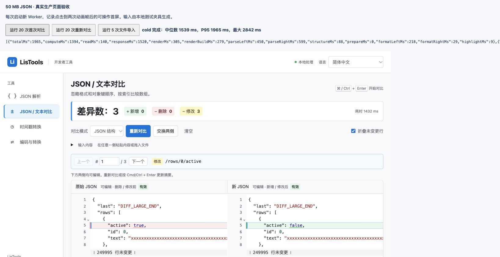
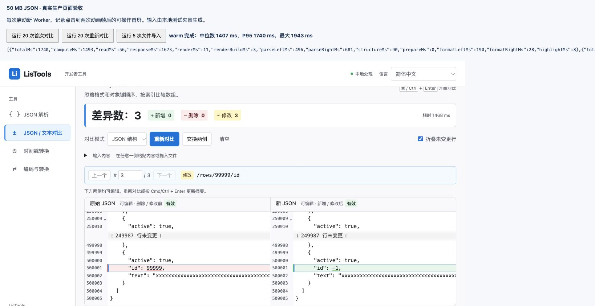

# 大 JSON 对比性能修复验收

日期：2026-10-15。项目：LisTools 1.1.0 候选版。没有新增依赖，也没有复用 FeHelper 源码。

## 瓶颈与修改

原始 50 MB 样例的 Worker 计算约 4.7 秒。分阶段计时发现，在结构比较已完成后，再对两份全文执行字符 diff 占据了大部分时间。

- JSON 模式直接使用 Microdiff 的完整结构差异生成文本范围，新增、删除通过共有相邻字段确定边界；只对变化范围进行有限的行内细化。字段计数不采样、不截断。
- 仅原始值变化时复用左侧排版，通过小补丁构建右侧。字符串引号、缩进和属性前缀复用现有缓存；数字仍按精确值比较，不以浮点数替代大整数或长小数。
- 文本模式继续复用 JsDiff 行比较和 CodeMirror 行内高亮。长行与复杂搜索有预算，必要时保留整段高亮，避免失控搜索；完整内容不截断。
- 上方输入区改用 CodeMirror 虚拟编辑器。实测其默认正则拆行在 50 MB 单行输入上可能耗时数秒，改为先用原生字符串拆行构造 CodeMirror `Text`，该阶段降到个位数毫秒；CR、CRLF 仍统一为 LF。
- 稀疏结果只传右侧补丁；Worker 确认输出与输入相同时直接复用不可变文档，省去相同全文传输。未编辑的视图保留，编辑过的文档重新生成差异视图并保留兼容的撤销记录。
- 文件读取期间预加载模块 Worker，正式比较复用该 Worker。取消、读取失败及过期输入都会清理任务。

没有替换严格解析器，没有修改重复键校验、左右错误归属、大数语义、JSON 字段计数或文本行块计数。

## 实际 Chrome 测试

使用构建后的生产页面，应用 manifest 相同的 CSP：本地脚本、模块 Worker、禁止网络连接。在真实 Chrome 中运行仓库内的文件导入夹具，通过真实 `File`、文件输入事件、UTF-8 解码和生产页面方法执行。

样例为左右各约 50 MB（51,688,924 / 51,688,456 字节），100,000 个对象，三处远距离差异：`/rows/0/active`、`/rows/50000/text`、`/rows/99999/id`。生成样例不计时，读取、输入准备、Worker 加载/计算/消息传输及可操作首屏计入页面总耗时；首屏在构建视图后两次动画帧记录。首次导入每次新建页面；重新比较每次仍执行新的 Worker 计算。

| 场景 | 次数 | 中位数 | P95 | 最大值 |
| --- | ---: | ---: | ---: | ---: |
| 首次完整文件导入 | 20 | 1,539 ms | 1,965 ms | 2,842 ms |
| 已排版文档重新对比 | 20 | 1,407 ms | 1,740 ms | 1,943 ms |

首次导入的 20 次中有 19 次低于 2 秒，重新对比 20 次均低于 2 秒。这里达到的是该样例的 P95 目标，没有达到每一次都低于 2 秒，也不承诺任意设备、文件结构或文件大小的固定耗时。最慢一次同时出现解析、排版和高亮耗时上升；未据此断言具体系统原因。原始数据见 首次导入样本（本地记录：`docs/diff-performance-cold-samples.json`） 和 重新对比样本（本地记录：`docs/diff-performance-warm-samples.json`）。

Node.js v26.4.0 的 10 次基准只计核心计算：中位数 371 ms，P95 379 ms；每次断言 3 处差异且高亮范围可重建完整右文档。这些数值与页面总耗时分开报告。原始样例和生成的大文件不进入 Git 或扩展 ZIP。





## 功能回归

- 50 MB 结果实际仅渲染 46 行 DOM，三处差异可依次定位到开头、中间和末尾，折叠并未截断数据。
- 下方大 JSON 尾部直接编辑后重新比较，完整耗时 1,929 ms，仍为 3 处差异；重建后撤销、重做可继续使用。
- 原始 `response_new.json` 与本地三处修改版：Chrome 生产页面完整导入为 351 ms，显示 3 处差异。由于浏览器自动上传接口要求额外文件 URL 权限，本次未扩大权限，原始内容通过临时本地 `File` 夹具进入同一导入流程。
- 上方两侧分别输入中文逗号与尾逗号：显示左右归属、中文原因、Unicode 和独立定位按钮；修正后恢复正确计数。
- 切换纯文本后可比较非 JSON 内容，远距离修改按两块计数，尾部行号和编辑后重算保持正确。

`npm test` 全量 122 项通过。包括 50 MB JSON/文本、1 MB 超长行、密集修改混合新增删除、全文重建、精确数值、特殊键、严格错误诊断、取消与过期结果隔离、文档复用、换行兼容与撤销重做。源码语法及 `git diff --check` 通过；项目没有配置 ESLint。

`npm run build` 已成功生成候选 ZIP。Vite 对现有 JSON 编辑器主入口的大 chunk 给出体积提醒，构建成功。

## 复现步骤

```sh
npm test
npm run build
node scripts/benchmark-json-diff.js 10
node scripts/prepare-diff-browser-benchmark.js
```

最后一个命令将生产包和测试页面复制到独立临时目录，输出启动命令。用 Chrome 打开输出的地址，分别执行 20 次首次对比和 20 次重新比较；页面提供每次的完整分项计时。测试夹具不进入扩展包。

## 交付边界

测试在真实 Chrome 的本地生产页面与扩展同等 CSP 下完成，不声称已在 `chrome-extension://` 协议中完成安装验收。可加载目录为 `dist/`，候选包为 `releases/LisTools-1.1.0.zip`。本次没有提交、推送或发布 GitHub Release。
