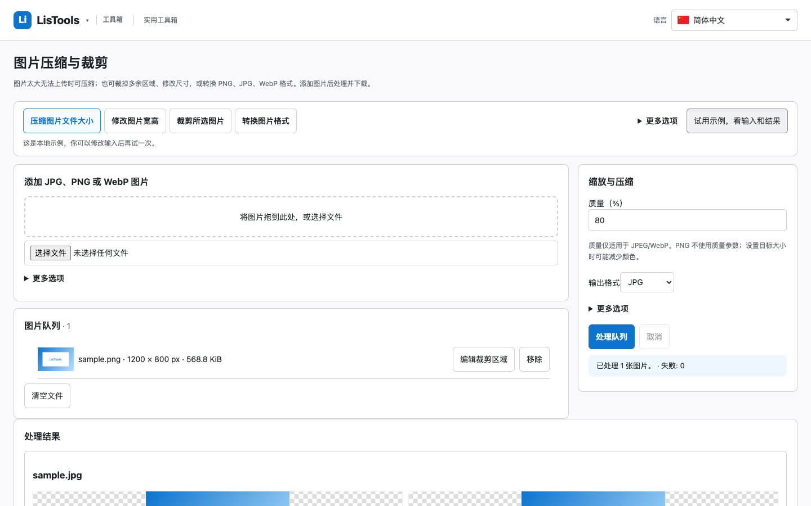
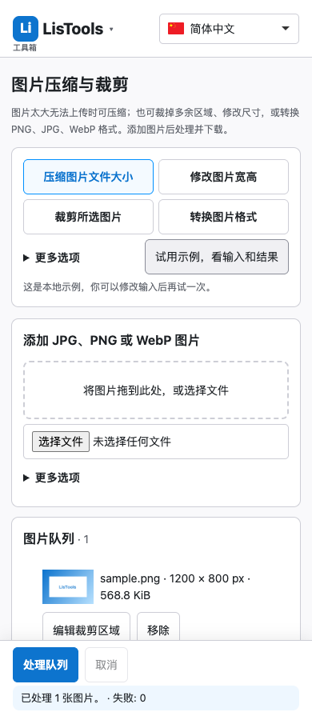
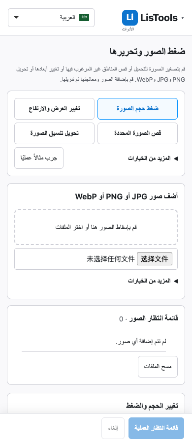

# LisTools 1.1.1 发布记录

1.1.1 修复文件与计算结果的正确性，以及连续操作和页面布局问题。保留18个工具页、50种语言和零扩展权限；复用已有库，未增加扩展权限、支付接口或输入持久化。

## 主要变化

- JSON 文件严格按 UTF-8 解码，支持 BOM；读取失败保留当前输入和结果，并让原有有效解析继续完成。
- MD5 在转换工作台中始终校验原文件完整字节；工作日正反计算遵循原始起止日期的包含规则；文本替换允许恰好100 MiB的有效结果。
- 图片导入和处理保留成功项，逐项说明失败原因；稳定文件ID对应预览与下载。裁剪、格式转换和缩放参数独立，质量仅对实际JPEG/WebP输出启用。
- 修复返回缓存后的裁剪、取消后的迟到错误、PDF切语言时忙碌状态、二维码解码失败后的取消状态。
- 标准计算器键盘和按钮统一以上次完整精度结果连算；科学模式和主动编辑表达式保留原语义。
- 正则操作不再覆盖自定义规则，应用预设前确认；单位换算默认突出单个主目标。
- 有用户内容时，其他工具在新标签页打开；同一转换工作台保留当前输入。菜单读取不影响倒计时到期提示。
- 图片/PDF桌面采用内容与参数双栏；文本、二维码和正则输入与结果分栏。窄屏、平板和短屏提供预留视口的底部操作区，状态与错误靠近操作，自动任务不抢焦点。
- 时区选择器增加本地国旗、国家/地区、城市和IANA名称搜索；HTML源码集中在pages目录，构建后的入口地址不变。

## 验证范围

| 检查 | 结果 |
| --- | --- |
| 单元测试 | 284通过 |
| Chrome155页面回归 | 168通过 |
| WebKit27.2页面回归 | 166通过，2项Chromium专用BFCache测试跳过 |
| 5种语言与8种屏幕组合、5类页面 | 200组通过 |
| Chrome for Testing149实际MV3加载 | 18个工具页及弹窗离线加载；Worker、图片ZIP、PDF下载、新标签页内容保护、真实200%缩放通过 |
| 页面异常及意外外部请求 | 0 |
| 扩展权限与host_permissions | 均为空 |

公开源码排除未完成支持页后，重新构建通过，284项单元测试、165项Chrome及163项WebKit回归通过，另2项Chromium专用测试跳过。安装包采用此前完成真实扩展验收的候选包；重复构建可能因打包排序和压缩命名产生不同字节，下载校验以下列SHA-256为准。

包文件：`LisTools-1.1.1.zip`，3,409,167字节、480个文件。SHA-256：

```text
988c434203d83239490a18e8cd73a4100747326fd494457537a7ef540db7dfe8
```

支持页因缺少作者确认的真实收款码，继续排除本次源码提交和安装包，其本地工作保留。没有发布任何扩展商店。

## 兼容性说明

Chrome120在本机加载扩展前即SIGTRAP退出，Firefox157因无法创建配置目录启动失败；两者本轮未完成验收。WebKit通过不等于原生Safari扩展验收。Edge、真机软键盘、平台屏幕阅读器及50种语言母语措辞审校尚未完成，不能声称已覆盖所有平台。

机器记录见[release-1.1.1.json](release-1.1.1.json)。此前版本的测试记录继续保留。

## 布局截图





