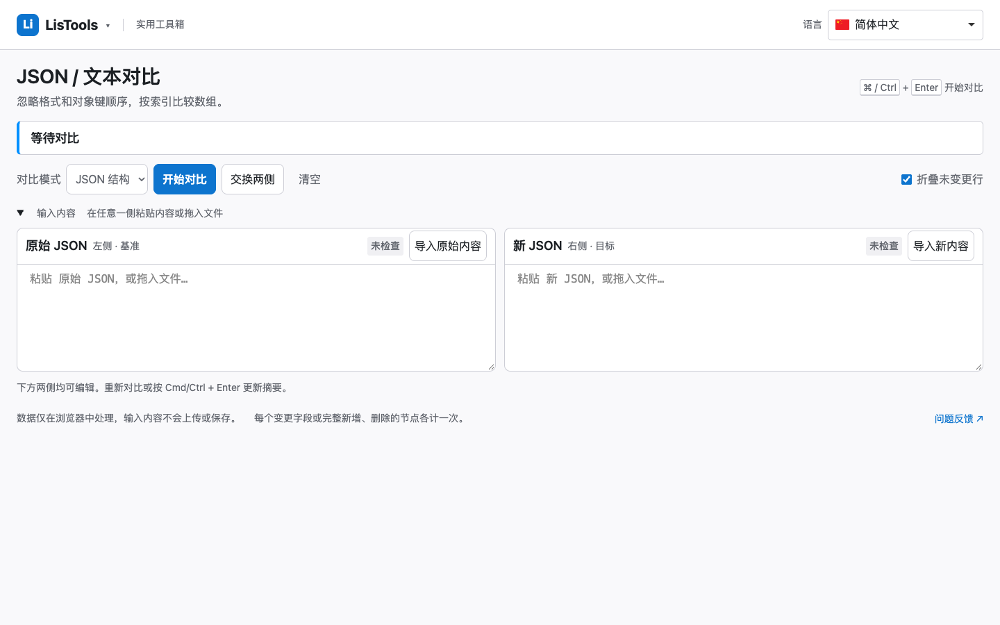
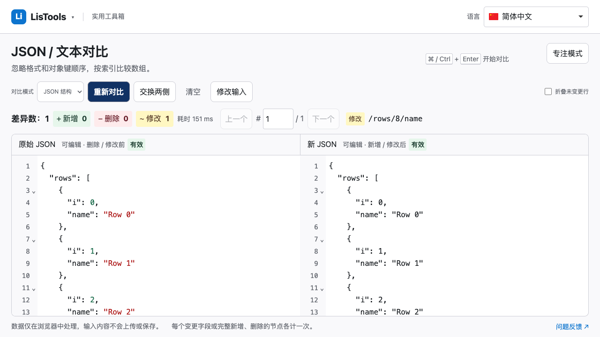
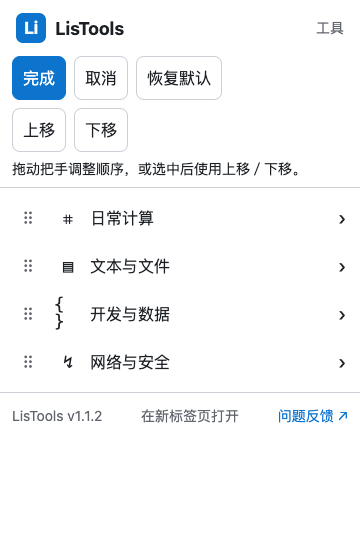
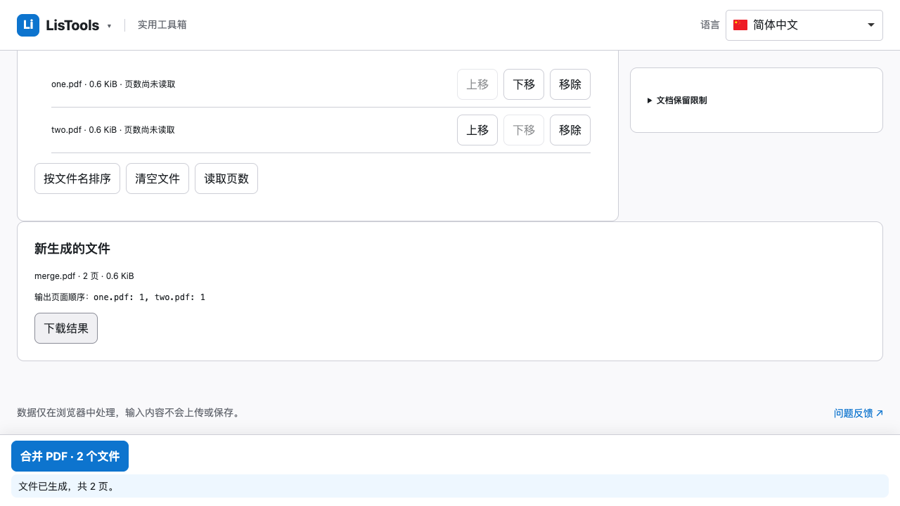
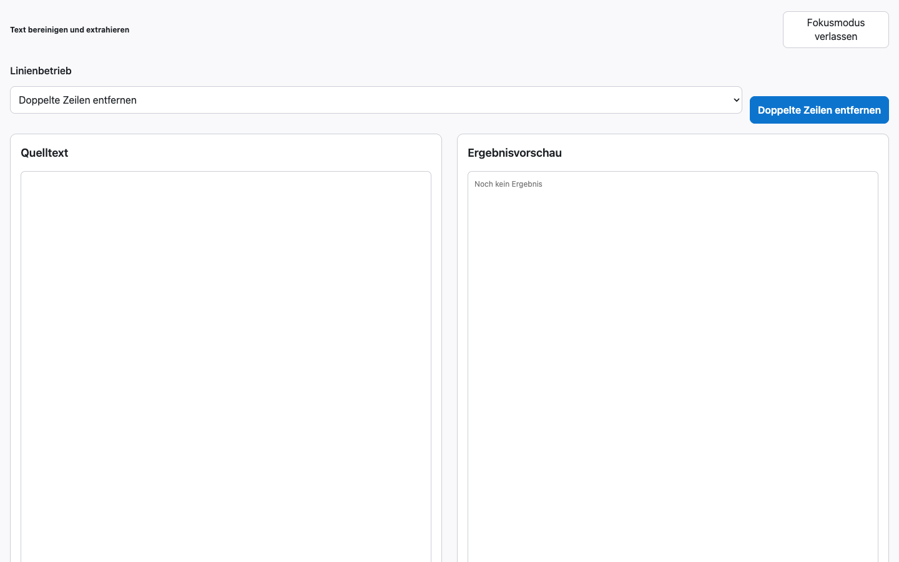

# LisTools 1.1.2 发布记录

本版交付菜单排序、长文本工作区、全站视觉与操作改进，修复重复选中和工具名称问题。保留18个独立工具页、MD5专用入口、37项转换及50种语言，零扩展权限。

## 主要变化

- 工具按日常计算、文本与文件、开发与数据、网络与安全分组，搜索可直达任务。分类和组内工具可拖动或键盘调整，完成保存、取消放弃草稿、恢复默认；页面菜单与弹窗共用本机偏好，不保存工具内容。
- 修复MD5与编码转换同时高亮；菜单打开时跟随任务与历史切换，当前工具保持唯一选中。菜单与标题统一完整名称，“正则测试”移除“开发用”后缀，旧搜索别名保留。
- JSON对比输入与结果占用主要工作区，默认展示未变更行。1440×900、1366×768实际阅读高度门槛为440px、320px；窄屏上下排列，每侧至少240px，保留虚拟渲染、末尾滚动和差异定位。
- JSON、对比、编码转换、MD5文本、正则和文本工具新增专注模式，切换保留内容、选区、撤销历史、滚动及任务。文件模式沿用列表。
- 正文和控件16px、辅助文案14px；按任务控制宽度，参数与主操作靠近输入，结果与导出相邻。二维码、图片、PDF按文件与任务状态组织；日期、单位、金额、抽签、计时器与计算器优化首屏比例。
- 全部自有界面接入50种本地语言，保留输入和结果；时区搜索含本地国旗，测速继续下载蓝色、上传红色与七档图片评价。

## 本次验证

| 检查 | 结果 |
| --- | --- |
| 锁文件安装、单元测试、正式构建 | 成功；294项单元测试通过 |
| Chromium155、Edge155、WebKit27.2完整页面回归 | 共809通过、7跳过、0失败；每个项目272项 |
| 实际Chrome for Testing149 MV3加载 | 从最终ZIP解压目录加载并断网；19主入口、计算器0.3、500行JSON对比、中文二维码、真实PDF合并及下载、弹窗排序跨页恢复、德语专注模式通过 |
| 语言、响应式、状态 | 页面回归覆盖50语言切换、RTL、320–2560px、长内容、取消／失败重试、结果保留与失效规则 |
| 页面异常／意外外部请求 | 实际离线扩展验收均为0 |
| 权限、支持页与资源 | 无permissions／host_permissions／后台；支持页及入口排除，许可证和国旗／语言资源完整 |

7项跳过仅发生于WebKit：CDP触屏及Chromium专用BFCache行为。此前Firefox157因配置目录问题、Chrome120因进程退出未完成验收，本次不计通过。WebKit页面通过不等于原生Safari扩展验收；触屏是模拟，未声称真机、屏幕阅读器或50种语言母语审校完成。弹窗同源页面与排序已测，原生工具栏弹窗生命周期不作已通过声明。

## 安装包与来源

正式ZIP直接包含manifest.json，可用于Chrome扩展开发者后台的“上传新软件包”；本地试用解压后在chrome://extensions选择“加载已解压的扩展程序”。GitHub自动生成的Source code为源码，需npm ci、npm test、npm run build后使用。本次没有提交Chrome商店审核。

- ZIP：LisTools-1.1.2.zip；487个文件、4,156,949字节。
- 解压后：12,532,339字节；19个HTML（18工具页和弹窗）。
- 相比1.1.1：文件数+7、ZIP+747,782字节（约21.9%）。
- 新增运行时依赖仅SortableJS1.15.7（MIT），本地打包，无CDN；原项目及传递依赖许可随包保留。
- SHA-256：`8e0a3de9ff1aedfa73985fac92e438e45c464687d52ea59749c027cf67a4115d`。

依赖审计报告1项既有fflate0.8.2中等告警：[GHSA-px8p-9vwx-vf98](https://github.com/advisories/GHSA-px8p-9vwx-vf98)针对畸形ZIP64的unzipSync。工具没有ZIP导入，产品仅使用压缩／打包，unzipSync只校验构建过程自己生成的包；本轮没有改动该依赖，也不宣称依赖审计零告警。

未完成支持页继续排除公开源码与安装包，原工作区源码、真实收款码缺失检查和历史包保留。机器记录、逐文件源码校验见[release-1.1.2.json](release-1.1.2.json)。

## 截图

改前对比输入：

最终扩展中的长内容与结果：

