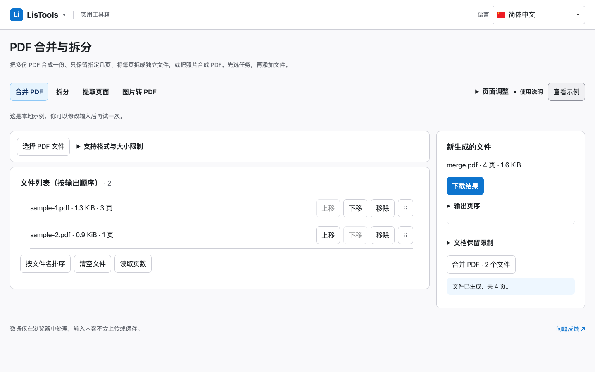
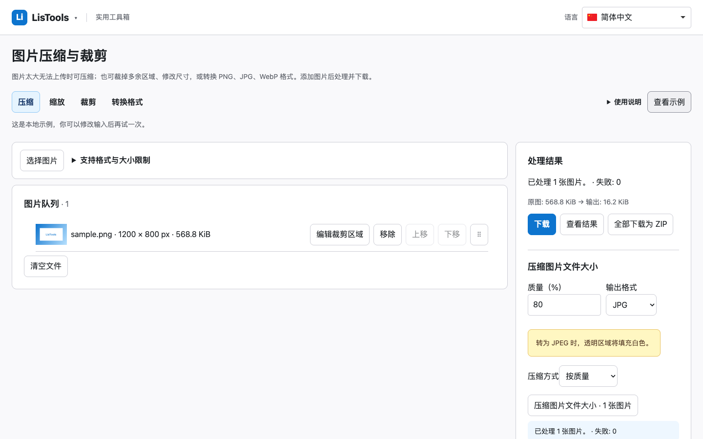

# LisTools 1.1.3 发布验收记录

本轮优先修复 PDF 文件选择、错误导入和菜单任务搜索，再完成已批准的全站流程调整。沿用 v1.1.2 的字号、长内容工作区、菜单排序、专注模式和全部计算能力；没有新增工具、运行时依赖或扩展权限。

## 主要修复

- 搜索任务的别名只匹配其所属工具；搜索邮箱、手机号不再出现无关 PDF 提取。搜索结果同时显示父工具和用途，深链接保持兼容。
- PDF 先校验当前任务允许的文件和文件头。全部拒绝时保留原队列与下载；混合导入逐项列出拒绝项。单文档任务明确选择当前 PDF；移除选中文档后必须重新选择，避免处理错误文件。
- PDF 页数来自本次请求实际文件，按文件对象对应，重排及同名文件不会串用页数。生成结果、页数、下载和页序集中呈现。
- 图片明确区分按质量和按目标大小；切换任务、清空正在编辑的目标值和语言切换保留模式。裁剪标记作用于当前图片，批量导出说明覆盖范围；结果优先显示实际体积、节省量、目标未达提示和下载。
- 图片与 PDF 复用已有 SortableJS 和上移／下移，空队列突出选择文件，有文件后导入区收紧。原文件不被覆盖。

## 逐页交付

| 页面 | 本轮完成或复核 |
| --- | --- |
| JSON | 保留完整编辑器、文本／树形、精度、自动处理和错误定位；专注及长内容回归。 |
| JSON／文本对比 | 保留足够阅读高度、默认完整内容、差异导航、编辑及撤销；500 行实际扩展比较通过。 |
| 编码与转换 | 保留 37 项、方向、当前限制、文件字节与完整导出；搜索不重复选中。 |
| MD5 | 保留独立入口、四模式、完整校验及逐项导出，无错误的“加密”功能声明。 |
| 时间戳 | 国旗搜索、自动识别、时区和完整时间结果、夏令时报错继续通过。 |
| Cron | 在结果中明确本次方言、字段数和时区；原生成器和预览保留。 |
| 密码 | 字符池与每类必含说明就近显示；低屏首屏主操作可见，默认遮挡及清理不变。 |
| 正则 | 提取方式说明贴近参数，保留匹配、捕获组、替换、规则库、取消及超时。 |
| 计算器 | 保留空白初始公式、标准／科学、DEG／RAD、Ans、彩色按键与高精度历史。 |
| 日期 | 输入和结果标题区分；工作日复制摘要包含休息和补班日期，原日历口径不变。 |
| 二维码 | 结果显示本次真实尺寸和纠错等级；输入修改后不残留旧元信息，生成／识别保留。 |
| 图片 | 当前图片裁剪、明确压缩方法、拖动队列、批量结果摘要与下载。 |
| PDF | 当前任务文件校验、显式当前 PDF、结果保留、页数对应及可见下载。 |
| 文本 | 将技术性的字符簇名称改为“可见字符”，Unicode 统计、六任务和完整导出保留。 |
| 单位 | “复制数值”仅复制完整标准数字；复制等式和复制全部换算独立，温度和量纲不变。 |
| 人民币大写 | 空白手动输入、主简体结果、舍入及其他格式继续复核，不改变金额算法。 |
| 抽签 | 显示参与、抽出或组数结论；单次抽取不误写为分组，随机算法不变。 |
| 计时 | 就近播报就绪、运行、暂停、到期，刷新恢复、分段和提示音保持。 |
| 测速 | 评级说明明确仅基于吞吐量；原七档图片、蓝下载／红上传和高清图表保留。 |
| 弹窗／菜单 | 任务搜索显示父工具与用途；四类排序、保存及页面间同步继续通过。 |

## 验证结果

- 实施前真实基线：294 项单元测试通过。最终工作区 `npm test`：296 项通过、0 失败；公开源码使用 `node --test --test-concurrency=1 test/*.test.js` 再次全量通过 296 项。并行复核时已有 50 MB 文本用例一次触发现有计算预算并返回粗略差异；单独复核及串行全量均通过，未放宽算法预算或修改断言。
- 最终 Chrome 可加载资源经本地预览：Chromium、Edge、WebKit 共 **878 项通过、7 项不适用跳过、0 失败、0 重试后通过**。新增 22 项针对本轮交互与真实数据的浏览器用例。
- 包括 320、390、768、1366、1440、1920、2560px 的现有响应式检查；中文、英文、德文和阿拉伯文代表性状态及 200% 文字放大。逐页重新采集桌面、手机、弹窗与实际示例共 43 组最终截图：无页面脚本错误、无整页横向溢出。
- 实际 Chrome **149.0.7827.55** 加载最终 MV3 目录并断网：19 个导航入口可用；`0.1+0.2=0.3`、500 行 JSON 对比、中文二维码、PDF 真实拖动页序及下载、图片 ZIP 真实拖动顺序、无效导入保留结果、弹窗排序同步及德语专注模式通过。无外部请求、无页面错误。
- 新增 31 个文案键覆盖 50 种语言，键和占位参数通过检查。只向已授权翻译服务发送项目界面文案，扩展没有接入翻译服务。结构覆盖和自动翻译初稿不等于 50 种语言母语审校。
- 独立审查发现的当前 PDF 移除回退、压缩参数显隐与参数标题三项问题均已修复，并补回归。

## 兼容性边界

Firefox 在页面加载前报告配置目录无法找到；Chrome 120 进程在页面加载前关闭，两者不计通过。WebKit 页面验证不代表 Safari 实际扩展安装。无头环境无法打开原生工具栏弹窗；已验证 popup 页面和共享状态。没有完成所有真实触屏设备、屏幕阅读器及 50 语言母语审校。7 项跳过针对 WebKit 不适用的 CDP／缓存行为。测网速仍需用户主动开始后连接既有 Cloudflare 公共节点。

## 产物与维护成本

- 正式 Chrome 资产：`LisTools-1.1.3.zip`，根目录直接包含 `manifest.json`，可在 Chrome 开发者后台上传新软件包；本地解压后选择“加载已解压的扩展程序”。本次没有提交商店审核。
- 487 个文件、19 份 HTML；ZIP **4,198,067 字节**，展开 **12,656,637 字节**。与 v1.1.2 相比增加 **41,118 字节（0.99%）**，展开增加 124,298 字节。
- SHA-256：`2d51ced66a95dfefccf4db48855758b20f9a2878006c50c322295fd0903f8832`。
- ZIP 与可加载目录逐文件字节一致。Chrome 资产去除 Firefox／Safari 元数据；源码的通用 Manifest 保留，通用资源可从源码构建。
- 运行依赖、许可证不变，复用现有模块；无新增权限、遥测、账号或数据持久化。支持页继续排除公开源码和安装包，原工作区支持源码与真实收款码缺失检查保留。
- 改动回写前校验 307 个基线文件全部匹配，231 个未涉及原文件保持哈希一致。历史包保留。

逐页改前／改后和实际结果截图另存 `LisTools-1.1.3-visual-verification.zip`，它是验收证据，不是扩展安装包。以下为最终包的合成 PDF 示例与图片结果；机器验收记录见 [release-1.1.3.json](release-1.1.3.json)。

