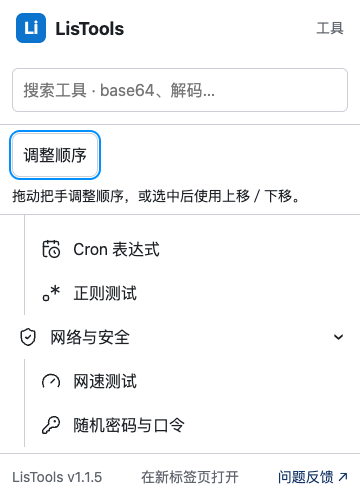
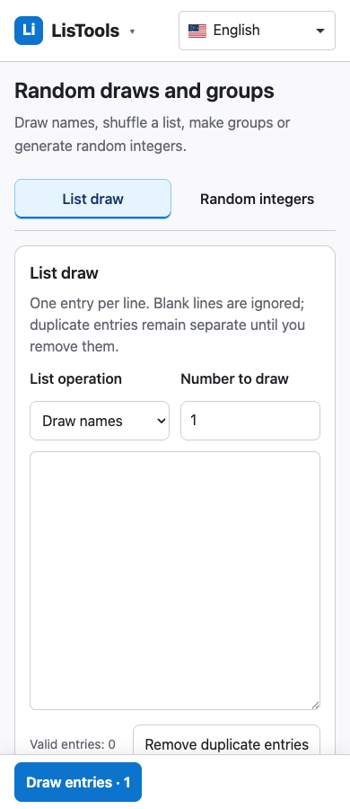
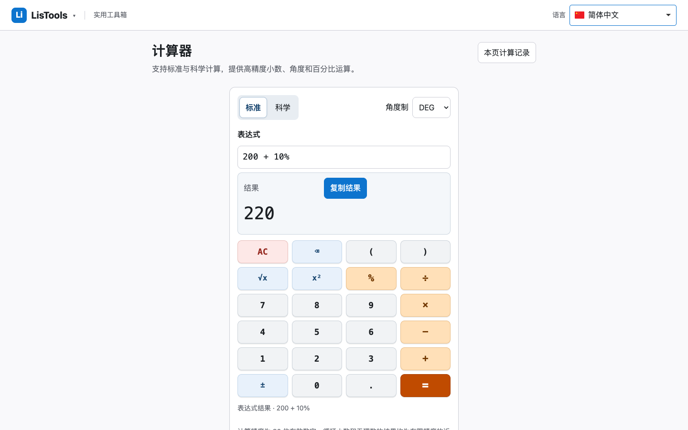

# LisTools 1.1.5 发布与验收

本版保留18个工具页面、MD5专用界面及37项转换，优化工作区比例、输入可读性、文件流程和菜单。复用现有组件，新增运行时/开发依赖均为0，扩展权限仍为空。

- Cron复用带本地国旗和搜索的时区选择器，保留自由IANA输入；正则、日期和单位主要输入更清楚。
- 长JSON对比完整阅读和导出；拒绝/取消导入保留既有对比结果。文本与文件模式分别保留当前页输入。
- PDF当前对象与队列一致，读取页数保留下载；图片切换前保护未保存裁剪。二维码中性无结果与失败区分。
- 计算器状态和结果不推动键盘，办公计算就近展示；日期任务状态独立，重复“今天”不清结果，抽签保留分任务结果。
- 修复抽签参数、计算器显示、二维码卡片和窄屏对比标题间距；保留大编辑区与专注模式。
- 菜单分类排序和展开偏好继续同步。真实弹窗根据Chrome可用高度调整列表，收起后自然缩小，版本和反馈入口在小屏/显示缩放时仍可用。

## 下载与构建

Chrome开发者后台上传 [LisTools-1.1.5.zip](https://github.com/Souvenirser/LisTools/releases/download/v1.1.5/LisTools-1.1.5.zip)。根目录直接含ManifestV3的 `manifest.json`。本地使用时解压并选择“加载已解压的扩展程序”。GitHub自动生成的Source code是源码，需要 `npm ci && npm run build`；源码的通用清单保留Firefox/Safari元数据，Chrome上传包按既有流程移除该字段。支持页草稿保留于原工作区，不包含在公开源码及安装包中。

## 实际验收

- 299项单元测试通过；公开发布源码另重新执行299项并构建，Chrome规范化后487个文件哈希与已验收安装包完全一致。
- 最终安装包Chrome464、Edge464、WebKit457项通过，共1385通过、7跳过、0失败、0重试后通过。
- 581个间距状态，380张页面状态截图及5张专注模式图；中/德/阿114次状态保留检查。人工重点复看问题页，不将截图数量视为逐图人工审校。
- 实际Chrome149扩展14项离线验收：19入口冷启动、Worker、真实文件与下载、50语言、200%原生缩放、长JSON末尾和完整复制、菜单同步与重启恢复。0应用异常、0外部HTTP请求。
- 原生工具栏弹窗另测800×600、1920×1440和125%显示缩放，共27个状态；检查收起/再展开、排序、搜索及列表滚动，版本与反馈文字完整可见且命中正确。

Firefox157与Chrome120在本机启动失败，未计通过；WebKit跳过1个Chromium CDP触屏及6个Chromium专有BFCache用例。WebKit页面通过不代表Safari原生扩展安装。VoiceOver、真实触屏和50语种母语审校未执行。没有替用户提交Chrome商店审核。

详细计数及边界见 [JSON记录](release-1.1.5.json)。测试绑定ZIP SHA-256：

```text
97f40a6410ad1fb1f987082856ca0744c49e96737185fb4869e9050b8f59975e
```

ZIP共4,295,616字节、487文件，与可加载目录逐项一致。

## 代表性界面








