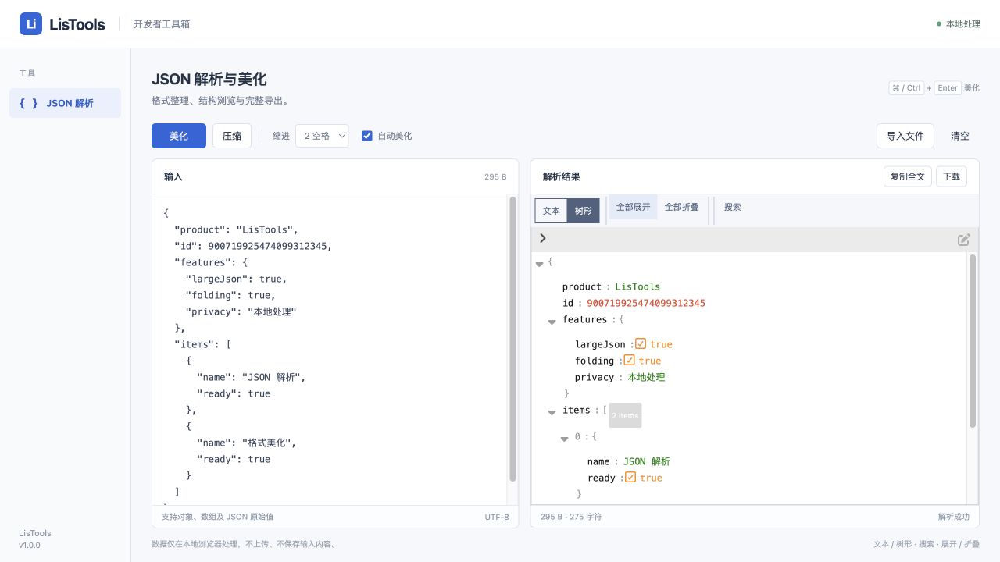
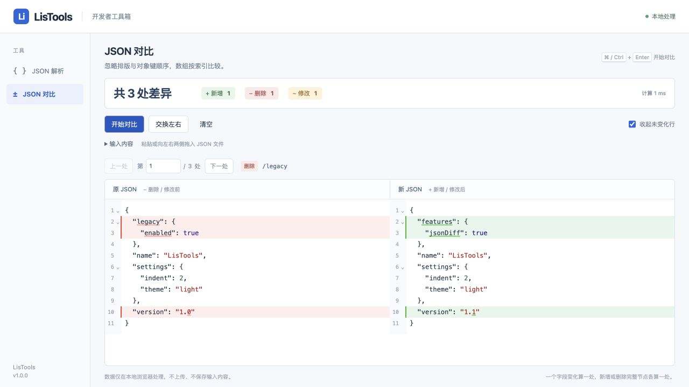

# LisTools 1.0.0 发布验证

2026-10-15。本次公开版本包含 JSON 解析、美化和双栏对比。

- 在独立目录执行干净依赖安装，锁文件与 package.json 一致。
- `npm test`：26 项 JSON 相关测试全部通过。
- `npm run build`：成功生成 Manifest V3 扩展与 ZIP。构建有编辑器分块超过 500 kB 的体积提示。
- 打包校验：版本一致、入口和引用资源完整、无远程入口资源，ZIP 根目录包含 manifest.json、MIT 许可证及第三方许可证。
- 扩展未申请网页访问权限，CSP 禁止远程连接。
- 本次发布未在真实 chrome-extension:// 协议下完成自动化加载验收；请按 README 在 Chrome 中加载并检查导入、复制、下载和对比。
- 本地开发记录、原始业务样例及含原始数据的截图未包含在公开源码或 ZIP 中。公开截图使用示例数据。

