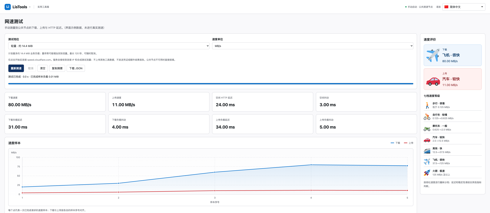
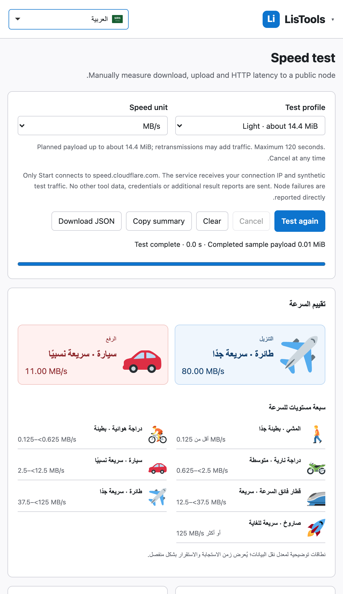

# 测速图片评价与工具页宽屏布局验收

2026-10-21。本轮交付当前工作树的可加载目录 `dist/`，沿用用户选择，暂不另外打包 ZIP。保留其他未提交修改和历史包，没有提交、推送或发布。

## 行为

测速结束后，下载和上传各自显示一张本地矢量图片、定性速度等级和实际测量值。档位按原始 bits/s 判断，切换 MB/s / Mbps 或界面语言不改变等级。

| 等级 | 吞吐速度（Mbps） |
| --- | --- |
| 步行 · 很慢 | 0 ≤ v < 1 |
| 自行车 · 较慢 | 1 ≤ v < 5 |
| 摩托车 · 一般 | 5 ≤ v < 20 |
| 汽车 · 较快 | 20 ≤ v < 100 |
| 高铁 · 快 | 100 ≤ v < 300 |
| 飞机 · 很快 | 300 ≤ v < 1000 |
| 火箭 · 极速 | v ≥ 1000 |

界面使用明确的上限排除符号，避免相邻档位重叠的理解歧义。这些是产品的趣味吞吐量分档，延迟和稳定性仍显示在原指标中。测试进行中不提前给出最终评价；取消或超时保留已有测量并标注部分结果，未测得的指标不归为最慢档。开始新测试、清空或修改档位时清除旧评价。复制摘要和 JSON 下载保留原字段并增加 `ratings.download` / `ratings.upload` 稳定等级 ID。

所有工具页共用的 `#tool-root` 移除 1600px 上限；原本已铺满的 JSON、对比、时间戳和转换页保留现有工作区布局。测速页在宽屏把图片评价放在右侧，窄屏置于控制区下方。改动不扩大到其他工具的业务功能。

## 开源复用

七张 SVG 原样复用 Twemoji v16.0.1，体积约 12.3 KB，无新增运行依赖、CDN、权限或自动联网。图片、署名、来源和完整 CC BY 4.0 许可证均打包到 `dist/speed-levels/`。源码说明见 [THIRD_PARTY_NOTICES](../THIRD_PARTY_NOTICES.md)。新增 19 个评价文案键覆盖现有 50 种语言；结构与占位符验证通过，不等同于母语审校。

## 验证

- `npm test`：278/278 通过。涵盖全部等级边界、无效/缺失值、原测量口径、请求保护、取消与超时、50 种语言键和占位符。
- Chromium / Firefox / WebKit 专项：27/27 通过，包含分档图片、部分结果、单位与语言切换、JSON 导出、清空重测、2550px 宽屏、320/640px RTL 和 1x/2x 清晰曲线。
- 三引擎全量回归：243/243 通过。18 个工具页均检查工作区宽度与窄屏 RTL，已覆盖其他工具及语言选择器。
- 真实 MV3 离线加载：Chrome for Testing 149，7 张图片全部可解码，18 个工具页在 2550px 窗口中均使用可用宽度，无页面异常、无 HTTP 请求，API permissions / host_permissions 仍为空。没有触发真实公共测速或产生合成流量。
- Vite 构建成功，素材与 dist 逐字节一致。现有大模块分块提示保留，不为本轮扩展重构范围。

独立复核确认分档、状态、导出和素材复用正确；指出的上限歧义已明确修正。首轮全量运行遇到并行测试清理共享输出目录，以及测试夹具在 SDK 准备前发送完成事件的问题；最终使用独立输出目录，并等待可见的样本值后再完成夹具，全部通过。

复现命令（Firefox 使用项目既有的独立应用目录处理本机配置目录问题）：

```sh
npm test
npx vite build
CFFIXED_USER_HOME=/private/tmp/listools-calculator-firefox npx playwright test --project=chromium --project=firefox --project=webkit --output=.superpowers/sdd/speed-rating/browser-results --reporter=line
```


## 效果图

下面使用固定本地示例数据展示界面，未进行真实测速。




